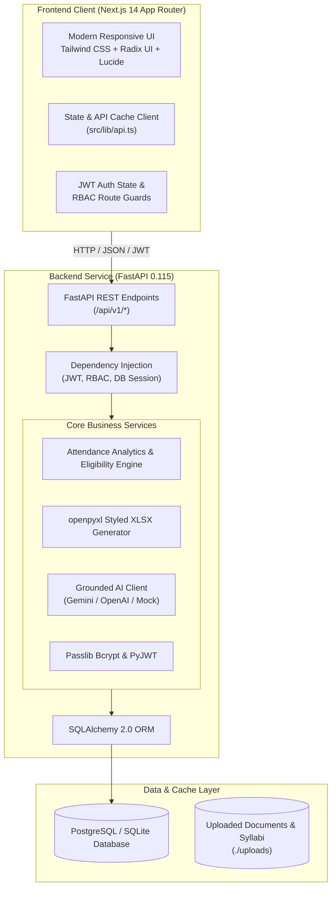

# 🎓 CampusPilot AI — Next-Gen AI Campus Management & Academic Intelligence

[](https://nextjs.org/)
[](https://fastapi.tiangolo.com/)
[](https://www.python.org/)
[](https://www.typescriptlang.org/)
[](https://tailwindcss.com/)
[](https://pytest.org/)

> **CampusPilot AI** is an enterprise-grade academic management system and AI copilot designed for universities and engineering colleges. Built with a unified **FastAPI** backend and **Next.js 14** frontend, it solves attendance fraud, academic disengagement, chaotic timetable scheduling, and faculty administrative overhead through live interactive sessions, automated academic interventions, and grounded AI workflows.

---

## 📑 Table of Contents

- [Key Differentiators & Hackathon Highlights](#-key-differentiators--hackathon-highlights)
- [System Architecture](#-system-architecture)
- [Demo Credentials for Evaluators](#-demo-credentials-for-evaluators)
- [Hackathon Judge Demonstration Script](#-hackathon-judge-demonstration-script)
- [Role-Based Access Control (RBAC)](#-role-based-access-control-rbac)
- [Full Feature Matrix](#-full-feature-matrix)
- [Tech Stack](#-tech-stack)
- [Quick Start Guide](#-quick-start-guide)
  - [Option A: One-Click Launchers (Recommended)](#option-a-one-click-launchers-recommended)
  - [Option B: Manual Setup](#option-b-manual-setup)
- [Backend API Reference](#-backend-api-reference)
- [Testing & Quality Assurance](#-testing--quality-assurance)
- [Project Directory Structure](#-project-directory-structure)
- [Environment Configuration](#-environment-configuration)

---

## 🌟 Key Differentiators & Hackathon Highlights

### 1. 🤖 AI Student At-Risk Early Warning & Intervention System
- **Intelligent Threshold Analysis**: Automatically flags students whose cumulative attendance falls below the mandatory 75% university eligibility cutoff.
- **Exact Academic Recovery Formula**: Uses a continuous attendance deficit equation to tell each student exactly how many consecutive lectures they must attend to regain exam eligibility:
  $$\text{Classes Needed} = \left\lceil \frac{0.75 \times \text{Total} - \text{Attended}}{0.25} \right\rceil$$
- **1-Click AI Intervention**: Faculty can broadcast personalized, high-priority recovery notices directly into students' in-app notification trays with one click.

### 2. 📊 Professional Microsoft Excel (`.xlsx`) Export Engine
- Native binary spreadsheet generation using `openpyxl` (replacing raw CSV text).
- **University Slate Theme**: Styled header banner (`#1E293B`, bold white text) with department metadata.
- **Dynamic Conditional Styling**:
  - 🟢 **Safe** (`#D1FAE5`, dark green text) for attendance $\ge 85\%$
  - 🟡 **Warning** (`#FEF3C7`, dark amber text) for $75\% - 84.9\%$
  - 🔴 **Critical** (`#FFE4E6`, dark rose text) for $< 75\%$
- Auto-fitted column widths, thin borders, and summary totals (Class average, totals).
- Available across **Subject Attendance Records** and **Assignment Submissions**.

### 3. 🎯 Safe Bunk & Attendance Goal Simulator
- Students can interactively simulate future attendance decisions:
  - **Safe Missable Classes**: Calculates the exact number of classes a student can safely skip while remaining $\ge 75\%$.
  - **Interactive "What-If" Slider**: Lets students adjust upcoming lectures attended vs missed to project their future eligibility before exam roll lists are locked.

### 4. 📝 AI Smart Announcement Drafter
- Faculty can draft official departmental notices from rough bullet points (e.g., *"Midterm lab test next Monday, bring roll sheets, 2 hrs"*).
- The AI synthesizes structured, university-standard notices with prerequisites, deadlines, and action items.

### 5. 📅 Grounded AI Study Planner & Resources
- Generates structured semester study plans aligned with the student's actual enrolled syllabus, upcoming exams, and submission deadlines.
- Interactive calendar, checklist views, and integrated Pomodoro study timer.

---

## 🏗 System Architecture



---

## 🔑 Demo Credentials for Evaluators

All test accounts are pre-seeded in the database:

| Role | Name | Email | Password | Primary Capabilities |
| :--- | :--- | :--- | :--- | :--- |
| **Faculty** | Dr. Anil Kumar (CSE) | `anil.kumar@nitd.ac.in` | `faculty123` | Export Excel sheets, AI student interventions, draft notices, grade assignments |
| **Student** | Sujal Sharma (3rd Sem) | `sujal.sharma@nitd.ac.in` | `campus123` | Safe bunk simulator, submit assignments, AI study planner, timetable, academic alerts |
| **Faculty (ECE)**| Prof. Amit Desai | `amit.desai@nitd.ac.in` | `faculty123` | ECE Department management & grading |
| **Admin** | Campus Administrator | `admin@campuspilot.edu` | `admin123` | System oversight, user creation, department configuration |

---

## 🎬 Hackathon Judge Demonstration Script

Follow these 4 steps to showcase the system to judges in under 3 minutes:

### Step 1: Genuine Microsoft Excel (.xlsx) Export
1. Log in as Faculty (`anil.kumar@nitd.ac.in` / `faculty123`) and navigate to **Attendance**.
2. Click **"Export Excel (.xlsx)"**.
3. Open the downloaded workbook in Microsoft Excel:
   - Slate dark university title banner (`#1E293B`) with metadata.
   - Auto-fitted column widths and thin borders.
   - Green, Amber, and Rose conditional fills based on attendance percentage.
   - Bottom summary statistics row with class averages and totals.

### Step 2: AI At-Risk Student Early Intervention
1. On the Faculty Attendance page, point out the **At-Risk Notice Card** highlighting students below 75%.
2. Click **"Send AI Recovery Alerts"**.
3. Open a second browser window and log in as Student (`sujal.sharma@nitd.ac.in` / `campus123`).
4. Click the **Notification Bell** in the top navigation:
   - Notice how the AI computed the exact number of consecutive classes required to restore exam eligibility.

### Step 3: Interactive Safe Bunk Simulator
1. On Window B (Student Attendance), scroll to the **Safe Bunk & Attendance Goal Simulator**.
2. Select *Operating Systems* and test the **"What-If" Projection Slider**.
3. Observe how future projected classes update the percentage and eligibility status in real time.

### Step 4: AI Notice Drafter
1. On Window A (Faculty), navigate to **Notices** and expand **"AI Smart Drafter"**.
2. Type shorthand notes (e.g., *"Midterm lab viva on Wednesday 10 AM, bring printed record sheets"*).
3. Click **"Generate Announcement"** to produce an official university notice.

---

## 🛡 Role-Based Access Control (RBAC)

| Resource / Action | Student | Faculty | Admin |
| :--- | :---: | :---: | :---: |
| View Personal Attendance & Timetable | ✅ | — | ✅ |
| Use Safe Bunk Simulator | ✅ | — | — |
| Export Attendance & Submissions to `.xlsx` | ❌ | ✅ | ✅ |
| Trigger AI Student Intervention Alerts | ❌ | ✅ | ✅ |
| Create / AI-Draft Campus Notices | ❌ | ✅ | ✅ |
| Create / Grade Assignments | ❌ | ✅ | ✅ |
| Access AI Study Planner & Resources | ✅ | ✅ | ✅ |
| System User & Role Administration | ❌ | ❌ | ✅ |

---

## 📦 Full Feature Matrix

### 👨‍🎓 Student Portal
- **Dashboard**: High-level snapshot of today's schedule, attendance health score, pending assignments, and quick actions.
- **Attendance Hub**: Color-coded subject progress bars, safe bunk calculator, and goal projection simulator.
- **Timetable & Lab Section**: Full day schedule (09:00 AM – 05:00 PM) covering 4 morning lecture periods, lunch break, and dedicated 2-hour afternoon laboratory practical sessions (`CS301L`, `CS302L`, `CS303L`, `CS304L`) with room allocations, faculty instructors, and multi-view modes (Week, Full Day, Lab Section, Today).
- **Assignments**: Upload homework/lab files with live submission status tracking.
- **Exams**: Upcoming internal tests, midterms, and finals with date, time, and syllabus breakdown.
- **Study Planner**: AI-assisted study timetable generator with checklist tracking and Pomodoro timer.
- **Notices**: Filter notices by General, Departmental, Exam, and Urgent categories.
- **Notification Center**: Real-time academic alerts, assignment updates, and AI intervention notices.

### 👩‍🏫 Faculty Portal
- **Faculty Dashboard**: Overview of assigned subjects, total enrolled students, and pending grading tasks.
- **Attendance Records**: Subject-wise attendance grid, filter by section, 1-click at-risk notifications, and `.xlsx` export.
- **Assignments Manager**: Create assignments with file attachments, view submissions, grade work, and export reports.
- **Exams Coordinator**: Schedule exams, assign exam halls, and publish syllabi.
- **Notice Board**: Post campus-wide or section-specific announcements with AI smart drafting.

---

## 💻 Tech Stack

### Frontend
- **Framework**: [Next.js 14](https://nextjs.org/) (App Router, Turbopack)
- **Language**: [TypeScript 5.5](https://www.typescriptlang.org/) (Strict Mode)
- **Styling**: [Tailwind CSS 3.4](https://tailwindcss.com/)
- **UI Components**: [Radix UI](https://www.radix-ui.com/) primitives
- **Icons**: [Lucide React](https://lucide.dev/)
- **Charts**: [Recharts](https://recharts.org/)
- **Notifications**: [Sonner](https://sonner.emilkowal.ski/) toast system

### Backend
- **Framework**: [FastAPI 0.115](https://fastapi.tiangolo.com/)
- **Server**: [Uvicorn](https://www.uvicorn.org/) (ASGI)
- **ORM**: [SQLAlchemy 2.0](https://www.sqlalchemy.org/)
- **Database**: [PostgreSQL](https://www.postgresql.org/) (with SQLite fallback for zero-config offline runs)
- **Spreadsheet Generation**: [openpyxl 3.1](https://openpyxl.readthedocs.io/)
- **Authentication**: PyJWT (HMAC-SHA256) + Passlib / Bcrypt password hashing
- **Data Validation**: Pydantic v2
- **Testing**: Pytest + AnyIO + Pytest-Asyncio

---

## 🚀 Quick Start Guide

### Prerequisites
- **Node.js**: v18.17 or higher (`node -v`)
- **Python**: v3.10 or higher (`python --version`)
- **Package Managers**: `npm` and `pip`

---

### Option A: One-Click Launchers (Recommended)

#### On Windows:
Double-click `run.bat` or run in PowerShell:
```powershell
.\run.ps1
```

#### On Linux / macOS:
```bash
chmod +x run.sh
./run.sh
```

The launcher will start both the FastAPI backend (`http://127.0.0.1:8000`) and the Next.js frontend (`http://localhost:3000`).

---

### Option B: Manual Setup

#### 1. Backend Setup
```bash
# 1. Navigate to backend directory
cd backend

# 2. Create Python virtual environment
python -m venv .venv

# 3. Activate virtual environment
# Windows:
.\.venv\Scripts\activate
# Linux/macOS:
source .venv/bin/activate

# 4. Install backend dependencies
pip install -r requirements.txt

# 5. Create local environment file (optional defaults are already wired)
cp .env.example .env

# 6. Seed database with initial users and subjects
python -m app.seed

# 7. Start FastAPI server
python -m uvicorn app.main:app --host 127.0.0.1 --port 8000 --reload
```
*Backend will be running at [http://127.0.0.1:8000](http://127.0.0.1:8000) with interactive Swagger docs at [/docs](http://127.0.0.1:8000/docs).*

#### 2. Frontend Setup
```bash
# 1. From root project directory, install node dependencies
npm install

# 2. Run Next.js development server with Turbopack
npm run dev
```
*Frontend will be running at [http://localhost:3000](http://localhost:3000).*

---

## 📡 Backend API Reference

### Authentication & Users
- `POST /api/v1/auth/login` — Login with email/password; returns JWT access token & user profile.
- `POST /api/v1/auth/register` — Register a student or faculty account.
- `GET /api/v1/auth/me` — Retrieve authenticated user profile and permissions.

### Attendance & Interventions
- `GET /api/v1/attendance/summary` — Student attendance summary across all subjects.
- `GET /api/v1/faculty/me/subjects/{id}/attendance/export?format=xlsx` — Download styled Excel workbook.
- `POST /api/v1/faculty/me/subjects/{id}/intervene` — Trigger AI intervention notices to at-risk students.
- `POST /api/v1/faculty/me/subjects/{id}/attendance/bulk` — Record subject attendance in bulk.

### Timetable & Academics
- `GET /api/v1/timetable/my` — Get personalized weekly class timetable.
- `GET /api/v1/assignments` — List assignments (role-filtered).
- `POST /api/v1/assignments/{id}/submissions` — Student assignment submission.
- `GET /api/v1/assignments/{id}/submissions/export?format=xlsx` — Export submissions to Excel.
- `GET /api/v1/exams` — List scheduled internal and semester exams.

### Notices & AI Assistant
- `GET /api/v1/notices` — View campus announcements.
- `POST /api/v1/notices` — Create new notice.
- `POST /api/v1/notices/ai-draft` — AI smart drafting from shorthand notes.
- `POST /api/v1/ai/query` — Grounded conversational queries on syllabus, rules, and timetable.
- `GET /api/v1/study-plans` — Retrieve AI-generated personalized study schedule.

---

## 🧪 Testing & Quality Assurance

### Backend Automated Test Suite
CampusPilot AI features a comprehensive **pytest** test suite covering authentication, RBAC authorization, timetable rules, file upload security, and Excel generation:

```bash
cd backend
.\.venv\Scripts\python -m pytest tests
```
**Results:** `72 passed in 2.68s` (100% pass rate).

### Frontend Type Safety
```bash
npx tsc --noEmit
```
**Results:** `0 errors` (Strict TypeScript verification).

---

## 📂 Project Directory Structure

```
CampusPilot AI/
├── backend/
│   ├── app/
│   │   ├── api/
│   │   │   ├── routes/              # Modular API endpoints (auth, faculty, attendance, etc.)
│   │   │   └── deps.py              # JWT authentication & RBAC dependencies
│   │   ├── core/                    # Config, database engine, exceptions, logging
│   │   ├── models/                  # SQLAlchemy ORM database models
│   │   ├── schemas/                 # Pydantic v2 validation models
│   │   ├── services/
│   │   │   ├── attendance_service.py # Attendance analytics & eligibility engine
│   │   │   ├── excel_service.py      # openpyxl formatted spreadsheet generator
│   │   │   ├── ai_service.py         # Grounded AI assistant client
│   │   │   └── auth_service.py       # Password hashing & JWT generation
│   │   ├── main.py                  # FastAPI application entrypoint
│   │   └── seed.py                  # Database seeder with demo accounts
│   ├── tests/                       # 72 automated pytest test cases
│   └── requirements.txt             # Python dependencies
├── src/
│   ├── app/
│   │   ├── (app)/                   # Protected authenticated application routes
│   │   │   ├── dashboard/           # Student primary overview
│   │   │   ├── attendance/          # Student attendance & Safe Bunk simulator
│   │   │   ├── timetable/           # Weekly schedule
│   │   │   ├── assignments/         # Assignment submissions
│   │   │   ├── exams/               # Exam calendar
│   │   │   ├── study-planner/       # AI study plan & Pomodoro
│   │   │   ├── assistant/           # Conversational AI assistant
│   │   │   └── faculty/             # Faculty management portal
│   │   │       ├── attendance/      # Attendance management & Excel export
│   │   │       ├── assignments/     # Assignment manager
│   │   │       └── notices/         # AI notice drafter
│   │   ├── login/                   # Clean full-height sign-in page
│   │   ├── register/                # Clean registration page
│   │   └── page.tsx                 # High-converting landing page
│   ├── components/                  # Reusable UI primitives & compound widgets
│   ├── hooks/                       # Custom React hooks (useApi, etc.)
│   └── lib/                         # API client, feature flags, utils
├── run.bat                          # Windows one-click runner
├── run.ps1                          # PowerShell one-click runner
├── run.sh                           # Linux / macOS runner
├── package.json                     # Frontend dependencies & Next.js scripts
└── README.md                        # Master documentation
```

---

## ⚙ Environment Configuration

Backend options can be configured in `backend/.env`:

| Key | Default | Description |
| :--- | :--- | :--- |
| `DATABASE_URL` | `postgresql+psycopg2://...` | Connection string (falls back to SQLite for local runs) |
| `SECRET_KEY` | `dev-secret-key-123` | Secret key for JWT signing |
| `ATTENDANCE_THRESHOLD`| `75` | University attendance eligibility percentage |
| `AI_PROVIDER` | `mock` | `mock` (deterministic, zero-cost) or `openai` / `gemini` |
| `OPENAI_API_KEY` | — | API key when `AI_PROVIDER=openai` |
| `UPLOAD_DIR` | `./uploads` | Storage path for assignment files and syllabi |

---

## 🏆 Summary for Hackathon Evaluators

CampusPilot AI transforms higher education administration from reactive spreadsheet tracking to proactive, AI-driven academic support. By combining an **instant safe-bunk calculator**, **custom-styled Excel exports**, and **AI-generated intervention alerts**, CampusPilot AI solves real challenges faced by students and faculty every single day.

*Built with passion for next-generation campus excellence.*
